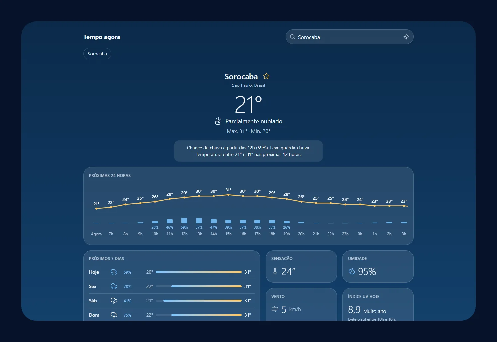
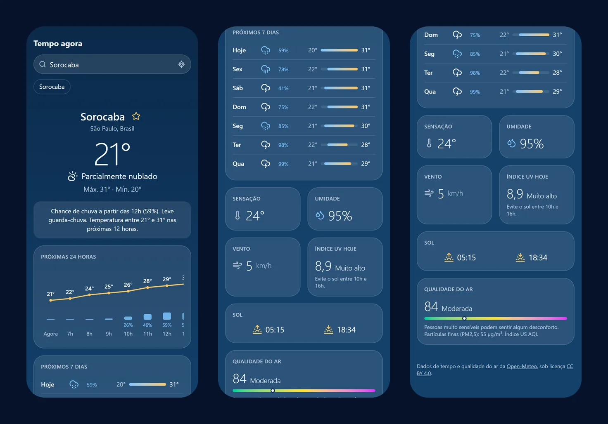

# Tempo agora

Previsão do tempo para qualquer cidade. A tela mostra:

- as condições de agora;
- uma frase sobre as próximas 12 horas ("leve guarda-chuva a partir das 17h");
- a previsão hora a hora e para 7 dias;
- a qualidade do ar, o índice UV e o nascer e o pôr do sol.

React 19, TypeScript, Tailwind e Vite, com dados abertos da [Open-Meteo](https://open-meteo.com/).



<details>
<summary>No celular</summary>



</details>

## O que faz

- **Busca com sugestões.** Ao digitar, aparecem as cidades com o nome parecido, com estado e
  país, para escolher a certa entre várias "Santa Rita".
- **Minha localização.** Usa a posição do navegador só para consultar a previsão. As coordenadas
  não ficam salvas.
- **Favoritas e recentes.** Atalhos no topo, guardados no navegador e conferidos ao ler.
- **Resumo das próximas 12 horas.** Avisa a primeira hora com 50% ou mais de chance de chuva e a
  faixa de temperatura.
- **24 horas em gráfico.** A linha mostra a temperatura, e as barras, a chance de chuva.
- **7 dias.** Mínima e máxima numa barra comparável entre os dias, condição e chance de chuva.
- **Qualidade do ar.** Índice US AQI e partículas finas (PM2,5), com a categoria e o que ela
  significa para atividades ao ar livre. Se esse serviço falhar, a previsão aparece sem ele.
- **Índice UV.** Máximo do dia, com as faixas da Organização Mundial da Saúde.

## Como funciona

A página consulta três serviços da Open-Meteo direto do navegador: geocodificação, previsão e
qualidade do ar. Nenhum deles exige chave, então não há segredo no código. A política de segurança
no `vercel.json` só permite conexões com esses três endereços, e a permissão de localização vale
só para o próprio site.

Se duas consultas se cruzarem, vale a última.

## Rodando localmente

Requer Node 22.12 ou mais novo.

```bash
npm install
npm run dev
```

```bash
npm run lint
npm test            # resumo, categorias, montagem da previsão e cidades guardadas (Vitest)
npm run test:e2e    # navegador, com a Open-Meteo simulada
npm run build
```

Os testes de navegador rodam no celular e no desktop, com a mesma política de segurança da Vercel.
Cobrem:

- a busca pela sugestão;
- a previsão completa;
- favoritas e recentes depois de recarregar;
- a previsão sem a qualidade do ar quando esse serviço falha;
- a cidade inexistente;
- a localização, conferindo que as coordenadas não foram salvas.

## Uso dos dados

- **Licença.** Os dados da Open-Meteo são CC BY 4.0. A atribuição está no rodapé.
- **Uso comercial.** A API gratuita da Open-Meteo é só para uso não comercial, com limite de
  10.000 chamadas por dia. Site com anúncio ou assinatura conta como comercial e precisa de um
  plano pago.

## Histórico

- **2022:** a primeira versão usava Create React App e a WeatherAPI, com a chave escrita no código.
- **2026:** migrei para Vite e troquei a API por uma que não precisa de chave.
- **Depois:** veio a previsão completa (horas, dias, qualidade do ar, UV, localização e favoritas)
  e a migração para TypeScript.
